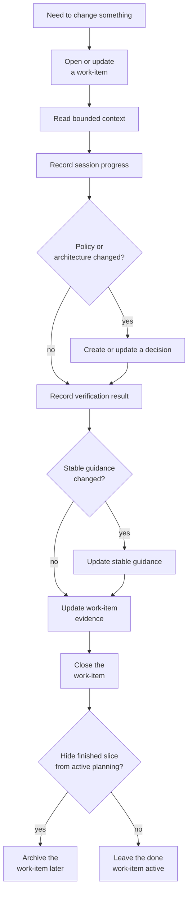
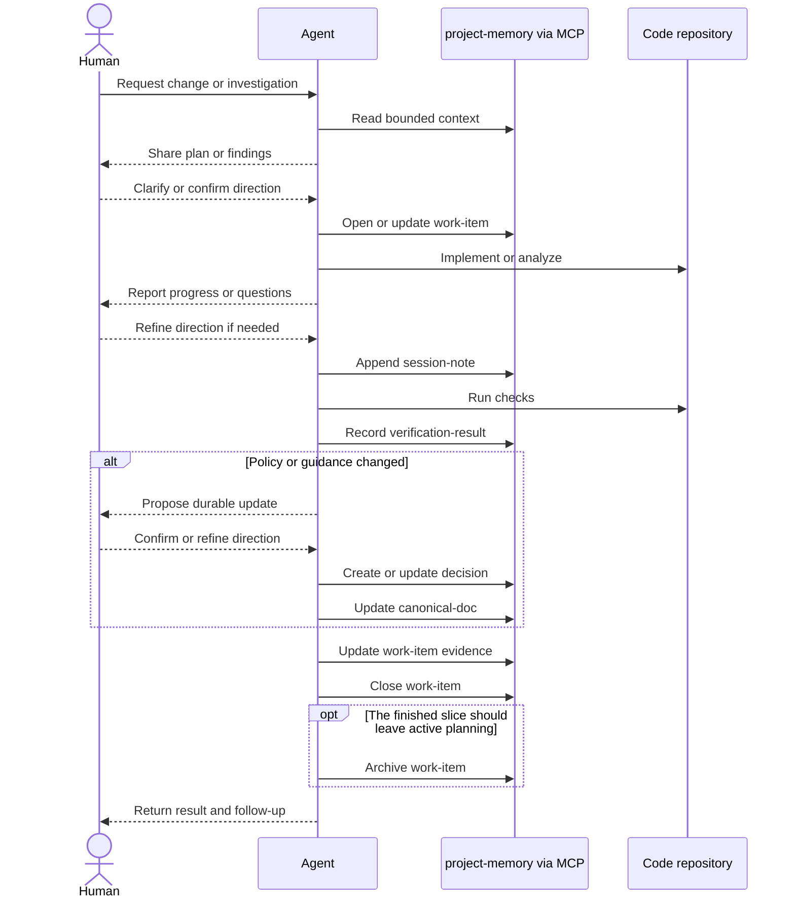

# Usage Guide

This guide assumes the core concepts from the [README](../README.md).
It focuses on how the managed document model is used during everyday work.

## Document Responsibilities

Each managed document type has one job.
Keeping those boundaries clear is what makes the repository readable for both agents and humans.

| Document type | Responsibility | Create or update it when | Do not use it for |
| --- | --- | --- | --- |
| `work-item` | Own one executable backlog slice | There is concrete work to do, track, block, resume, or close | Durable architectural truth or long-form session history |
| `session-note` | Record what happened during one work session | You want a chronological trace of actions taken, findings, and follow-up | Stable policy, backlog ownership, or repeatable procedures |
| `decision` | Capture durable rationale and chosen direction | A change sets or revises policy, constraints, or architecture, and a non-draft record should capture the stable-guidance review outcome explicitly | Ad-hoc progress notes, raw test evidence, or silent replacement of an older durable record |
| `verification-result` | Capture evidence that something was checked | A test, validation step, smoke check, or review produced a result | Broad narrative context or future planning |
| `canonical-doc` | State current stable guidance for one scoped topic | A topic has settled enough to need a maintained source of current truth | Session chronology or unresolved exploration |
| `runbook` | Define a repeatable operational procedure | Someone should be able to execute the same procedure later | One-off implementation notes or policy arguments |
| `provider-note` | Capture stable guidance for working with one provider | A provider has constraints, quirks, or usage guidance worth preserving | Generic architecture, backlog tracking, or session logs |

The intended paradigm is:

1. `work-item` owns the execution slice.
2. `session-note` records what happened while executing it.
3. `decision` records durable reasoning when policy changes, while non-draft decisions also capture the explicit stable-guidance review outcome.
4. `verification-result` records proof that something was checked.
5. `canonical-doc`, `runbook`, and `provider-note` hold stable reference knowledge after the work settles.

For `work-item` specifically, `evidence` is where the execution slice links back to the documents that justify closure.
In normal practice that means:

- at least one `session-note` locator for execution chronology
- zero or more `verification-result` locators for checks that completed

If a `work-item` is marked `done`, it must have at least one `session-note` in `evidence`.

Use `list-documents --preset backlog` for executable work only and `list-documents --preset ideas` for the draft-decision inbox that still needs triage.

## Model Lifecycle

A normal documentation lifecycle is described first as model operations, not as shell commands:

1. Open or update the `work-item` that owns the current slice.
2. Read bounded context for the topic, rationale, and dependencies that matter.
3. Perform the implementation, investigation, or migration work in the relevant repository.
4. Record session-level progress in a `session-note`.
5. Record a `verification-result` when a meaningful check completes. If the slice included code changes, do this before `done` and describe the checks that actually ran.
6. If stable policy or architecture changes, create a `decision`. For non-draft decisions, record one explicit stable-guidance review outcome as part of the write.
7. If long-lived guidance changes, update the relevant `canonical-doc`, `runbook`, or `provider-note`. If guidance does not change, the decision should still record that review outcome explicitly.
8. Update the `work-item` so its `evidence` links to the relevant `session-note` and `verification-result` records.
9. Close the `work-item` when the slice is done.
10. Archive the `work-item` later only if the finished slice should leave the active planning surface.
11. Commit memory-repo changes separately from code-repo changes.
12. Push the memory-repo branch explicitly when the local commit should sync to a remote.

The important closure rule is explicit:

- `close_work_item` changes terminal execution state
- it does not create `session-note` or `verification-result` records for you
- it does not add their locators to `evidence`
- a `done` `work-item` must already include at least one `session-note` locator in `evidence`

For feature and change work, the lifecycle usually looks like this:



This process keeps the memory repo understandable after the session ends.
The next human or agent should be able to answer:

- what was being worked on
- what happened during execution
- what decisions became durable
- what evidence supports the current state
- what remains open

## Decision Write Contract

`decision` has two distinct operating modes:

- `draft` decisions are the idea inbox. They do not require a stable-guidance review outcome and should not be used as the final durable record.
- non-draft decisions are durable records. They must include an explicit stable-guidance review outcome when written.

For non-draft decisions, the review outcome should make one of these states explicit:

- stable guidance was reviewed and no change was required
- stable guidance was reviewed and a follow-up update is required
- stable guidance was reviewed and updated in the same change slice
- a bootstrap-style exemption was used because no prior stable-guidance surface existed yet

This keeps the handoff between immutable rationale and mutable current guidance explicit instead of relying on a reader to infer whether stable reference docs were checked.

Decision writes are also immutable by path.
If a durable decision already exists at the same dated topic path, create a new decision record instead of silently overwriting the old one.

## Example: One Iteration

The same lifecycle becomes more concrete when shown as one end-to-end iteration through MCP:



## Installation

For install and bootstrap, use the onboarding flow in the [README](../README.md).
This guide starts after the tool repo and external memory repo already exist.

## Scenario: Start A Work Session

Do not start by scanning the whole memory repo.
Start with a bounded read that matches the question you are trying to answer.

Use the entrypoints as concrete system operations:

1. Read `cold-start` when you need startup context for a project.
2. Read `planning-backlog` when you need to know what work is ready, in progress, or blocked.
3. Read `planning-topic-entry` when one work-item topic needs exact dependency, context, and evidence follow.
4. Read `topic-entry` when you need the current truth for one topic.
5. Read `rationale-entry` when you need the durable reasoning behind a policy or decision.
6. Open or update the relevant `work-item` before the active slice drifts into undocumented execution.

The point is not convenience alone.
These entrypoints keep reads narrow, deterministic, and explainable so the caller does not have to rediscover repository boundaries every session.

## Validation And Path Rules

The managed surface is stricter than a generic markdown repository:

- documents outside the managed path model are ignored by list and search entrypoints
- direct reads and writes to disallowed paths fail instead of silently creating unmanaged records
- invalid frontmatter fails validation on read and write
- documents that match the path layout but violate the managed schema are rejected until corrected

In practice, this means the memory repo is not defined by "all markdown files under version control".
It is defined by markdown files that satisfy both the path model and the managed document contract.

## Scenario: Backlog Triage And Work-Item Execution

For backlog work, `work-item` is the authoritative execution unit.
Planning should not depend on scattered session notes or recent decisions alone.

Use planning reads as a short operational sequence:

1. Read the backlog to identify what is ready, in progress, or blocked right now.
2. Open one planning topic entry to inspect its explicit dependency, context, and evidence surfaces.
3. Decide whether the `work-item` should be started, resumed, blocked, or closed.
4. Update the `work-item` and related documents so the next planning read reflects both the new state and the explicit evidence links that justify it.

For closure specifically, the shortest safe pattern is:

1. append or identify the `session-note`
2. record the `verification-result` if meaningful checks completed
3. update the `work-item` `evidence`
4. close the `work-item`
5. archive later only if the finished slice should disappear from active planning

`read-planning-topic-entry` starts from exact-topic same-project work items and then follows only explicit same-project references:

- dependency work items
- context documents
- evidence documents

The read remains bounded and deterministic.

## Scenario: Repository Move Or Migration

This scenario is about migrating existing operational documentation into a managed `project-memory` repository.
It is not the same thing as moving one already-managed memory repo to another filesystem location.

Typical migration shape:

- identify the current source documents and decide which managed document type each piece of information belongs to
- create `work-item` records for the migration slices instead of trying to rewrite everything in one pass
- move chronological execution history into `session-note`
- move durable rationale into `decision`
- move stable current guidance into `canonical-doc`, `runbook`, or `provider-note`
- record verification when migrated material is reviewed or validated

Example:

- `legacy/notes/2025-q4-rollout.md` becomes one or more `session-note` entries if it mostly records chronology, actions, and follow-up
- `legacy/architecture-decisions.md` is split into durable topic-level `decision` documents
- `legacy/ops-checklist.md` becomes a `runbook` if it is truly procedural, or a `canonical-doc` if it is current stable guidance rather than a step-by-step operation
- the migration itself is tracked through a `work-item`, and review of the migrated output is captured in a `verification-result`

The important goal is not to preserve the old folder layout.
The goal is to re-express the information in the managed taxonomy so future bounded reads and planning flows become reliable.

## CLI Reference Surface

Use the CLI for exact local maintenance, scripting, and debugging.
For the overall operating model, see the core concepts in the [README](../README.md).

Current local entrypoints:

```bash
./scripts/run-cli.sh <command> ...
./scripts/run-mcp.sh
```

Representative CLI operations:

- list or search documents when you already know what you are looking for
- inspect one exact path directly
- run lifecycle operations such as close or archive
- stage and commit managed document changes through the validated commit helper
- push the committed memory-repo branch through an explicit remote-sync helper

Example commands:

```bash
./scripts/run-cli.sh list-documents --project acme-api
./scripts/run-cli.sh list-documents --project acme-api --preset ideas
./scripts/run-cli.sh create-decision --project acme-api --topic repository-split --context "Need a durable repo boundary." --decision "Keep project memory in a separate repository." --consequences "separate git history|explicit memory sync" --stable-guidance-review reviewed-no-change --date 2026-03-14
./scripts/run-cli.sh read-document --path projects/acme-api/decisions/2026/2026-03-14-repository-split.md
./scripts/run-cli.sh close-work-item --project acme-api --topic bounded-read-follow-up --date 2026-03-14 --state done
./scripts/run-cli.sh commit-pending-changes --message "docs(acme-api/session): record setup validation"
./scripts/run-cli.sh push-pending-changes --remote origin
```
